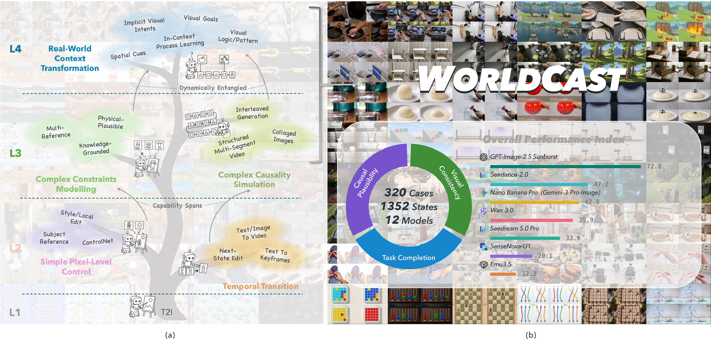
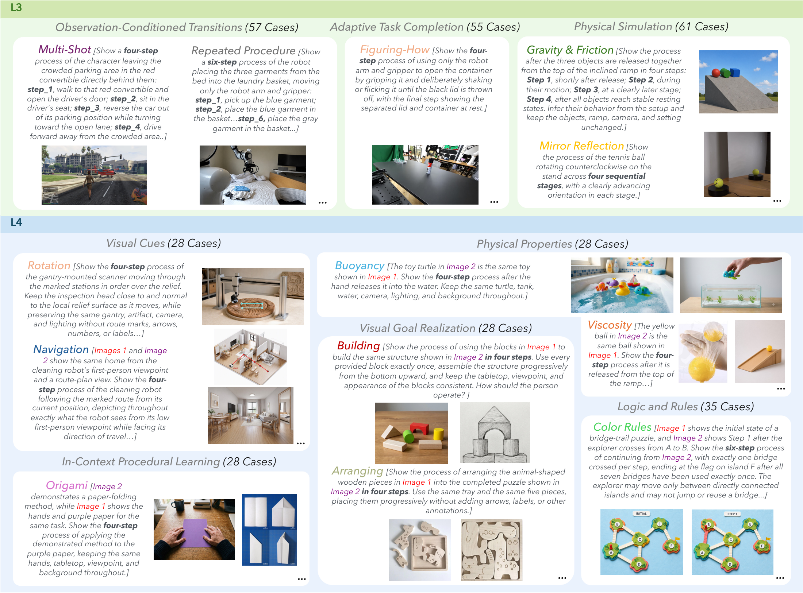

# WorldCast: Exploring Intelligent Visual Generation in World State Prediction

<div align="center">

[](https://arxiv.org/abs/2610.20731)
[](https://teal024.github.io/WorldCast/)
[](https://huggingface.co/datasets/wenhaoyan77/WorldCast)
[](docs/evaluation.md)

</div>

<p align="center">
  
</p>

WorldCast is a benchmark for **world state prediction** in visual generation: given
observations and diverse references, a model must generate the sequence of future
states that a process goes through, not just a plausible final image. Such a task
is demanding for unified systems, multi-reference image models, and video models
alike, because it requires understanding and generation to work together: the
model has to work out what each reference means, when it takes effect, and how the
world changes as a result. We offer both a benchmark of 320 manually designed
cases and a common evaluation protocol that scores grid, interleaved, and video
outputs as one ordered sequence of states, together with a diagnosis of 12
representative models.

## 🔥 News

- **`2026.10.12`** Released the WorldCast dataset, evaluation toolkit, and Judge rubrics.

## 👀 Introduction

**Higher-level generative capabilities are underexplored.** We organize visual
generation into a four-level capability tree. L1 is static text-to-image
generation. L2 adds pixel-level control and temporal transition, such as editing,
subject reference, and text- or image-to-video. L3 requires modelling complex
constraints and simulating complex causality, with multiple references, world
knowledge, and physical plausibility. L4 requires transforming real-world context
into action: implicit visual intents, spatial cues, visual goals, demonstrated
procedures, and logical patterns. Frontier models have moved quickly through L1
and L2, yet L3 and L4, where understanding and generation must be tightly
integrated, are rarely measured.

**Real-world processes are dynamic, and references do more than fix appearance.**
Prior work mostly asks whether a model can simulate the world from a static
appearance anchor such as a first frame or a subject image. In real tasks,
references intervene at different points of a process. A reference may be a state
to observe, a goal to reach, a rule to obey, a material property, or a
demonstration of how something is done. We call this **world state prediction**:
using heterogeneous context to guide an evolving real-world process. The model
must reason about each reference before it can draw the next state.

**One protocol for image and video models.** Whether a model produces a grid,
interleaved text and images, or a continuous video, its success must show up in
the resulting visual states. WorldCast therefore evaluates every output as an
ordered sequence of key frames, and each case carries human-annotated HINTS that
tell the GPT-5.5 Judge what a correct sequence must show.

**What we find from this benchmark:**

- **Frontier unified systems show early-stage world state prediction.**
  GPT-Image-2.5 scores 72.8 and handles some L3 and even L4 tasks, with emerging
  generalization across categories.
- **The gaps between models are large and widen at higher levels.** Nano Banana
  Pro reaches 42.8 and the best open-source model 20.1. Complex context, entangled
  references, and reasoning-heavy tasks are the common failure points.
- **Interleaved generation helps image models.** Generating one state at a time
  with a text plan lets frontier image models capture critical temporal
  transitions without a video architecture.
- **Strong generators draw on their language models.** Performance gaps track
  language-side planning and reasoning. Adding agentic abilities such as
  inspection-and-revision loops and coding tools brings further gains and exposes
  new challenges.

## 📊 Benchmark

WorldCast has **320 manually designed cases** requesting **1,352 visual states**
across **eight task categories**. Every case comes with human-annotated HINTS that
tell the Judge what a correct sequence must show.

<p align="center">
  
</p>

## 🏆 Leaderboard
| Model | Type | Format | L3 | L4 | Overall |
| --- | --- | --- | ---: | ---: | ---: |
| **GPT-Image-2.5** | Proprietary image | Interleaved | **73.8** | **71.6** | **72.8** |
| GPT-Image-2 | Proprietary image | Interleaved | 68.3 | 63.7 | 66.2 |
| Seedance 2.0 | Video | Video | 51.9 | 41.6 | 47.2 |
| Nano Banana Pro | Proprietary image | Interleaved | 45.6 | 39.5 | 42.8 |
| Gemini Omni | Video | Video | 45.8 | 36.8 | 41.6 |
| Wan 3.0 | Video | Video | 46.0 | 32.8 | 39.9 |
| Seedream 5.0 Pro | Proprietary image | Grid | 36.8 | 29.9 | 33.6 |
| SenseNova-U1 | Open-source image | Interleaved | 24.4 | 15.0 | 20.1 |
| Seedream 4.5 | Proprietary image | Grid | 17.6 | 14.1 | 16.0 |
| Emu3.5 | Open-source image | Interleaved | 16.5 | 7.4 | 12.3 |
| BAGEL | Open-source image | Plan & iterate | 6.7 | 6.8 | 6.8 |
| Qwen-Image | Open-source image | Grid | 6.9 | 4.0 | 5.6 |

Scores are on a 0–100 scale.
GPT-Image-2.5 is paired with GPT-6 Astra, and GPT-Image-2 with GPT-5.5.

## 📥 Dataset

The benchmark is hosted on Hugging Face at
[wenhaoyan77/WorldCast](https://huggingface.co/datasets/wenhaoyan77/WorldCast).

```python
from datasets import load_dataset

dataset = load_dataset("wenhaoyan77/WorldCast", split="test")
```

Each case provides the text `prompt`, the ordered `initial_images`, the number of
requested `steps`, the `target_grid` layout for grid models, and the Judge-only `hints_by_metric` and `hint_images`. See the
[dataset card](docs/dataset_card.md) for all fields.

## 🚀 Installation

Requires Python 3.10+.

```bash
git clone https://github.com/teal024/WorldCast.git
cd WorldCast
pip install -e .
```

The Judge is GPT-5.5 with medium reasoning effort, called through the OpenAI
Responses API. Set `OPENAI_API_KEY` before running an evaluation.

## 🔧 Quick Start

### Step 1: Download the benchmark

```bash
worldcast download data/
```

This writes one folder per case:

```text
data/
└── <case_id>/
    ├── case.json            # prompt, steps, category, HINTS
    ├── reference_01.png     # input images, in prompt order
    └── hint_01.png          # Judge-only reference (few cases)
```

### Step 2: Generate

Give your model each case's `prompt` and `initial_images`, and save the generated
states in order. Do not give the model the HINTS or hint images.

```text
outputs/<model>/
└── <case_id>/
    ├── 1.png
    ├── 2.png
    └── ...
```

Images are ordered by filename. The prompt wrappers used for each generation
format are in [`worldcast.adapters`](src/worldcast/adapters.py) and shown in
[docs/prompts.html](docs/prompts.html).

**Grid models.** A model that draws all steps in one image is scored on the
individual cells. Put the grids in `grids/<model>/<case_id>.png` and run:

```bash
worldcast split-grids data/ grids/<model> outputs/<model>
```

The grid is cut into equal cells in reading order, following each case's
`target_grid`: `1x2` for 2 steps, `2x2` for 4 steps and `2x3` for 6 steps.

**Video models.** A video has to be converted into an ordered set of key frames
before it can be scored. In the paper this is done by an **Agentic Video
Adapter**: GPT-6 Astra at medium reasoning effort, run as an agent through
Codex, inspects the video and
selects the frames that cover as many of the requested states as possible while
keeping their temporal order. The adapter only decides which frames show the
required states. It does not judge the quality or plausibility of the video.
Put the videos in `videos/<model>/<case_id>.mp4` and run:

```bash
worldcast extract-frames data/ videos/<model> outputs/<model> --workers 4
```

This needs `ffmpeg` and an authenticated [Codex CLI](https://learn.chatgpt.com/docs/non-interactive-mode).
The frames are written to `outputs/<model>/<case_id>/`, ready for Step 3. The
prompt template is in [docs/prompts.html](docs/prompts.html#AVA).

To try the video pipeline on a small synthetic example:

```bash
python examples/make_video_example.py outputs/video-demo
worldcast extract-frames outputs/video-demo/data outputs/video-demo/videos outputs/video-demo/frames
worldcast run outputs/video-demo/data outputs/video-demo/frames --results outputs/video-demo/results
```

### Step 3: Evaluate

```bash
worldcast run data/ outputs/<model> --results results/<model> --workers 4
```

This calls the Judge and consumes model quota. Each case's scores are written to
`results/<model>/<case_id>.json`. Completed judgments are cached in `checkpoints/`,
so an interrupted run can simply be started again. Use `--cases 519 520` to
evaluate a subset.

### Step 4: Summarize

```bash
worldcast summarize results/<model>
```

This prints the score per category, per level, and overall.

To inspect the exact Judge requests for a single case without calling any model:

```bash
python examples/make_example.py outputs/demo
worldcast evaluate outputs/demo/case.json --dry-run
```

## 📏 Evaluation

| Component | Score | Generated images shown to the Judge |
| --- | --- | --- |
| Progress Alignment (PA) | 0–2 | Full sequence |
| Outcome Completion (OC) | 0/1 | Final image only |
| Causal Plausibility (CP) | 0–3 | Full sequence |
| Visual Consistency (VC) | 0–3 | Full sequence |

Task Completion combines PA and OC with the case's outcome weight
`w = result_weight / 100`. Process-focused cases have `w = 0` and skip OC.

```text
TC      = 1.5 × ((1 − w) × PA + 2 × w × OC)
Overall = (TC + CP + 0.5 × VC) / 7.5 × 100
```

Step Accuracy (SA) is an optional per-step analysis for interleaved models and
does not enter the overall score. The full rubrics are in
[docs/rubrics.html](docs/rubrics.html), and the input format and scoring details
are in the [evaluation guide](docs/evaluation.md).

## 📁 Repository Structure

```text
WorldCast/
├── src/worldcast/           # Evaluation toolkit and CLI
│   └── resources/           # Judge rubrics used by the evaluator
├── scripts/                 # Dataset build and upload, rubric rendering
├── docs/                    # Evaluation guide, dataset card, rubrics, prompt templates
├── examples/                # Synthetic image and video cases for a trial run
└── tests/                   # Offline tests, no model calls
```

## 📝 Citation

```bibtex
@misc{yan2026worldcast,
  title={WorldCast: Exploring Intelligent Visual Generation in World State Prediction},
  author={Yan, Wenhao and Li, Haodong and Li, Xiaotong and Luo, Yaxin and Yue, Zhengrong and Zou, Jialv and Huang, Xu and Yang, Haojin and Jia, Nan and Feng, Yan and Pei, Peng and Cai, Xunliang},
  year={2026},
  eprint={2610.20731},
  archivePrefix={arXiv},
  url={https://arxiv.org/abs/2610.20731}
}
```

## 📄 License

The code is released under the [MIT License](LICENSE). The dataset is released
under [CC BY 4.0](https://creativecommons.org/licenses/by/4.0/).
